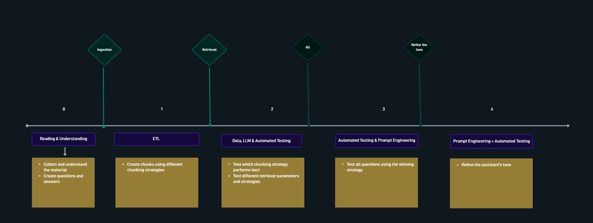

# RAG Pipeline

A reusable RAG (retrieval-augmented generation) pipeline framework: Postgres/pgvector-backed
ingestion + hybrid retrieval + evaluation, meant to be reused across future projects — drop new
docs in `kb/`, write new eval questions, reuse the rest. Companion to the sibling course project
`../ai-agent-sales`: follows that course's RAG *mechanics* (staged ingestion, pluggable chunking,
hybrid search, phased evaluation) but drops everything CRM/sales-specific.

## Roadmap



| # | Phase | What it covers |
|---|---|---|
| 0 | **Ingestion** | Collect/understand source material, write eval questions & answers, stage + chunk + embed docs |
| 1 | **Retrieval** | Chunking strategies (ETL) — build chunks under different strategies |
| 2 | **AG** | Test which chunking strategy performs best; test retriever parameters/strategies |
| 3 | **Refine the tone** | Automated testing across all questions with the winning strategy |
| 4 | *(prompt engineering)* | Refine the assistant's tone via prompt engineering + automated testing |

**Current state:** Phase 0 (ingestion) is implemented — see [`docs/ingest.md`](docs/ingest.md).
Retrieval (`rag/search.py`) and evaluation (`eval/run.py`) are still stubs.

## Setup

- Python 3.11+ (`python3.11`, not the system default).
- `python3.11 -m venv .venv && .venv/bin/pip install -r requirements.txt`
- Copy `.env.example` to `.env` and fill in:
  - `OPENROUTER_API_KEY` — embeddings, routed through OpenRouter's OpenAI-compatible endpoint
    (`openai/text-embedding-3-small`, 1536-dim).
  - `DB_USER`/`DB_PASSWORD`/`DB_HOST`/`DB_PORT`/`DB_NAME`/`DB_SSLMODE` — Supabase Postgres, via
    the **session pooler** (see [`docs/database.md`](docs/database.md)).
  - Optional: `COHERE_API_KEY` (reranking), `LANGSMITH_API_KEY` (tracing).

## Usage

```bash
make migrate                                              # apply sql/*.sql
make ingest BASE_DIR=kb/empresa_x STRATEGY=fixed EMPRESA=empresa_x
```

See `make help` for all `make ingest` variables (strategy, chunk size/overlap, skip-stage,
truncate, ...), or run the pipeline as a LangGraph graph (`rag/ingest.py:graph`) directly —
`langgraph dev` picks it up via `langgraph.json` as `rag_ingest`.

## Testing

```bash
make test                        # pytest -m phase0 (default) against tests/rag/
make test PYTEST_MARK=phase1     # any other marker from pytest.ini
```

`tests/rag/` mirrors `../ai-agent-sales/tests/rag/`'s layout and fixtures. Its `clean_db` fixture
truncates `kb_docs`/`kb_chunks` before every test — point `DB_*` at a dev database, not one with
data you care about.

## Docs

- [`docs/database.md`](docs/database.md) — schema, connection, search functions.
- [`docs/ingest.md`](docs/ingest.md) — ingestion pipeline: chunking strategies, embeddings,
  LangGraph graph, `make ingest` reference.
- `CLAUDE.md` — full architecture notes for working on this repo with Claude Code.
